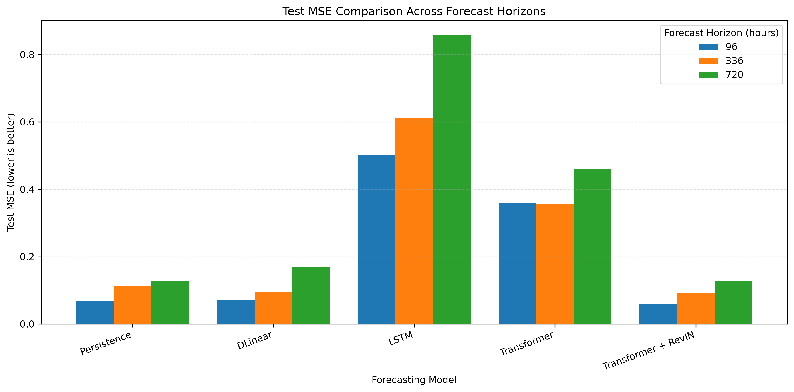
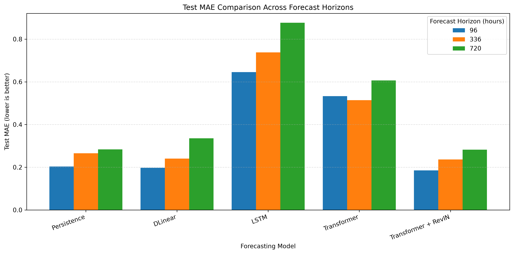

# ELE680 — Long-Horizon Time-Series Forecasting

**Course:** ELE680 — Deep Neural Networks  
**University:** University of Stavanger (UiS)  
**Group:** 2  
**Group Members:** Dilhani Jayawickrama and Parneet Kaur Dhanoa

## 1. Project Overview

This project investigates whether increased model complexity improves long-horizon time-series forecasting performance using the Electricity Transformer Temperature (ETTh1) dataset.

**Research Question: Does increased model complexity improve long-horizon forecasting performance?**

We compare five forecasting approaches:

- Persistence baseline
- DLinear
- Long Short-Term Memory (LSTM)
- Transformer
- Transformer with Reversible Instance Normalization (RevIN)

All models are evaluated using a fixed 96-hour input window and forecasting horizons of 96, 336, and 720 hours.

Performance is assessed using Mean Squared Error (MSE), Mean Absolute Error (MAE), model parameter counts, and recorded training times.

## 2. Dataset

The project uses ETTh1, a publicly available hourly time-series dataset from the Electricity Transformer Temperature benchmark introduced by Zhou et al. [1].

**Dataset source:** [ETDataset — Original GitHub Repository](https://github.com/zhouhaoyi/ETDataset)

| Property | Description |
|---|---|
| Dataset | ETTh1 |
| Number of observations | 17,420 |
| Sampling frequency | Hourly |
| Number of variables | 7 |
| Forecasting target | Oil Temperature (OT) |
| Input sequence length | 96 hours |
| Forecasting horizons | 96, 336, and 720 hours |

The seven variables are HUFL, HULL, MUFL, MULL, LUFL, LULL, and OT.

Only `ETT-small/ETTh1.csv` is used for the experiments.

## 3. Data Preprocessing

Data preprocessing is implemented in `02_ETTh1_Preprocessing.ipynb`.

The pipeline includes:

- Data quality checks for missing values, duplicate records, and timestamp regularity.
- Chronological splitting into training, validation, and test sets.
- Feature standardization using `StandardScaler` fitted only on training data to prevent data leakage.
- Sliding-window generation with a 96-hour input sequence.
- Target generation for 96-, 336-, and 720-hour forecasting horizons.
- Conversion into PyTorch tensors.

The chronological split is:

| Dataset split | Observations |
|---|---:|
| Training | 8,640 |
| Validation | 2,880 |
| Test | 2,880 |

The ETTh1 dataset contains 17,420 hourly observations. Following the selected chronological benchmark split, the first 8,640 observations (12 months) were used for training, the next 2,880 observations (4 months) for validation, and the following 2,880 observations (4 months) for testing. The remaining 3,020 observations were excluded from the experiments. This splitting strategy preserves temporal ordering and prevents future observations from being included in the training period.

Processed tensors are saved in the `processed_data/` directory.

## 4. Forecasting Models

### 4.1 Persistence Baseline

The Persistence baseline predicts future target values using the last observed oil temperature. It provides a simple reference for evaluating the neural network models.

### 4.2 DLinear

DLinear is a linear forecasting model investigated by Zeng et al. [2].

It provides a computationally efficient comparison against more complex neural network architectures.

### 4.3 LSTM

The Long Short-Term Memory (LSTM) model uses recurrent neural network mechanisms to learn temporal dependencies in historical observations.

### 4.4 Transformer

The Transformer model uses attention mechanisms to model relationships between observations within the input sequence.

### 4.5 Transformer with RevIN

Reversible Instance Normalization (RevIN), introduced by Kim et al. [3], is applied to the Transformer model to address distribution shifts in time-series data.

The normalization and de-normalization operations aim to improve forecasting robustness.

## 5. Experimental Setup

The experiments were conducted using PyTorch on the UiS Gorina4 computing server.

| Configuration | Value |
|---|---|
| Input sequence length | 96 hours |
| Forecasting horizons | 96, 336, 720 hours |
| Evaluation metrics | MSE and MAE |
| Framework | PyTorch 2.5.1 |
| GPU | NVIDIA Tesla P100 |
| GPU allocation | GPU 0, shared with Group 1 |

All models are evaluated using chronological training, validation, and test partitions.

MSE and MAE are reported on the standardized target scale.

## 6. Results and Discussion

### 6.1 Test MSE Comparison

Lower MSE indicates better predictive performance.

| Model | 96h | 336h | 720h |
|---|---:|---:|---:|
| **Transformer + RevIN** | **0.059003** | **0.091872** | **0.128817** |
| DLinear | 0.064651 | 0.095971 | 0.167763 |
| Persistence | 0.069300 | 0.113274 | 0.129179 |
| Transformer | 0.359840 | 0.355421 | 0.459745 |
| LSTM | 0.501855 | 0.612728 | 0.857829 |

### 6.2 Test MAE Comparison

| Model | 96h | 336h | 720h |
|---|---:|---:|---:|
| **Transformer + RevIN** | **0.185151** | **0.236748** | **0.282477** |
| DLinear | 0.187502 | 0.240374 | 0.335462 |
| Persistence | 0.203300 | 0.265204 | 0.283409 |
| Transformer | 0.532816 | 0.514123 | 0.606255 |
| LSTM | 0.645748 | 0.737606 | 0.876643 |

### 6.3 Visual Comparison

**Test MSE across forecasting horizons**



**Test MAE across forecasting horizons**



### 6.4 Key Findings

Transformer + RevIN achieved the lowest test MSE and MAE across all three forecasting horizons.

Compared with the Persistence baseline, Transformer + RevIN reduced test MSE by approximately 14.86%, 18.89%, and 0.28% for 96h, 336h, and 720h forecasting, respectively.

DLinear achieved competitive performance at 96h and 336h despite using substantially fewer parameters than the Transformer-based models.

At 720h, the Persistence baseline slightly outperformed DLinear.

The standard Transformer and LSTM performed worse than Persistence across all evaluated horizons.

These results indicate that model complexity alone does not guarantee improved forecasting accuracy. Normalization and architectural choices can strongly influence forecasting performance.

## 7. Project Structure

```text
ELE680_Group2/
├── ETT-small/
│   └── ETTh1.csv
├── 01_ETTh1_Exploration.ipynb
├── 02_ETTh1_Preprocessing.ipynb
├── 03_ETTh1_Baseline_Models.ipynb
├── 04_ETTh1_DLinear.ipynb
├── 05_ETTh1_Transformer.ipynb
├── 06_ETTh1_LSTM.ipynb
├── 07_ETTh1_Model_Comparison.ipynb
├── 08_ETTh1_Model_Comparison_With_Transformer.ipynb
├── processed_data/
├── saved_models/
├── checkpoints/
├── results/
├── figures/
├── explore_etth1.py
├── requirements.txt
├── README.md
└── LICENSE
```

**Directory descriptions:**

- `ETT-small/`: Original ETTh1 dataset.
- `processed_data/`: Preprocessed PyTorch tensors.
- `saved_models/`: Saved DLinear checkpoints.
- `checkpoints/`: Saved LSTM checkpoints.
- `results/`: Model evaluation results and comparison CSV files.
- `figures/`: Forecasting visualizations, training curves, and model comparison figures.

The consolidated model results are stored in `results/Final_Model_Comparison_5Models.csv`.

## 8. Environment Setup

### 8.1 Computing Environment

| Component | Configuration |
|---|---|
| Server | UiS Gorina4 |
| Python | 3.12.15 |
| Conda environment | `ele680` |
| PyTorch | 2.5.1+cu118 |
| PyTorch CUDA runtime | 11.8 |
| GPU | NVIDIA Tesla P100-PCIE-12GB |
| GPU memory | 12 GB |

### 8.2 Activate the Conda Environment

On Gorina4, load Miniconda:

```bash
uenv miniconda3-py312
```

Activate the existing environment:

```bash
conda activate ele680
```

For a new environment, create it first:

```bash
conda create -n ele680 python=3.12
conda activate ele680
```

### 8.3 Install Dependencies

Install the project dependencies:

```bash
python -m pip install -r requirements.txt
```

The requirements file specifies the CUDA 11.8 PyTorch wheel repository and PyTorch 2.5.1.

Verify dependency compatibility:

```bash
python -m pip check
```

### 8.4 Verify PyTorch and CUDA

```bash
python -c "import torch; print('PyTorch:', torch.__version__); print('CUDA available:', torch.cuda.is_available()); print('GPU:', torch.cuda.get_device_name(0) if torch.cuda.is_available() else 'None')"
```

Verified output on Gorina4:

```text
PyTorch: 2.5.1+cu118
CUDA available: True
GPU: Tesla P100-PCIE-12GB
```

### 8.5 GPU Configuration

Group 2 was assigned GPU 0, shared with Group 1.

Check GPU usage:

```bash
nvidia-smi -i 0
```

To select GPU 0 in a fresh Python process, set the environment variable before importing PyTorch:

```python
import os
os.environ["CUDA_VISIBLE_DEVICES"] = "0"

import torch
```

GPU-intensive experiments should be coordinated between the groups.

## 9. Running the Project

The project notebooks are organized as follows:

| Notebook | Description |
|---|---|
| `01_ETTh1_Exploration.ipynb` | Exploratory data analysis |
| `02_ETTh1_Preprocessing.ipynb` | Data preprocessing and sliding windows |
| `03_ETTh1_Baseline_Models.ipynb` | Persistence baseline |
| `04_ETTh1_DLinear.ipynb` | DLinear experiments |
| `05_ETTh1_Transformer.ipynb` | Transformer and RevIN experiments |
| `06_ETTh1_LSTM.ipynb` | LSTM experiments |
| `07_ETTh1_Model_Comparison.ipynb` | Initial model comparison |
| `08_ETTh1_Model_Comparison_With_Transformer.ipynb` | Final model comparison |

Open the notebooks in VS Code or Jupyter using the `ele680` Python environment.

The dataset exploration script can also be executed with:

```bash
python explore_etth1.py
```

The final experimental results are available in `results/Final_Model_Comparison_5Models.csv`. The figures are available in `figures/`.

The saved results can be inspected without retraining the models. Reproducing all experiments may require executing the preprocessing and training notebooks.

## 10. Conclusions

The experimental findings show that increased model complexity does not necessarily lead to better long-horizon forecasting performance.

Transformer + RevIN achieved the best predictive performance across the evaluated horizons. However, DLinear remained competitive at shorter horizons while requiring significantly fewer parameters.

The standard Transformer and LSTM did not outperform the Persistence baseline in the evaluated configurations.

The results highlight the importance of normalization, model selection, and comparison with simple baselines.

These conclusions are specific to the ETTh1 dataset and the experimental configurations used in this project.

## 11. References

[1] Zhou, H., et al. (2021). *Informer: Beyond Efficient Transformer for Long Sequence Time-Series Forecasting.* AAAI Conference on Artificial Intelligence.  
https://arxiv.org/abs/2012.07436

[2] Zeng, A., et al. (2023). *Are Transformers Effective for Time Series Forecasting?* AAAI Conference on Artificial Intelligence.  
https://arxiv.org/abs/2205.13504

[3] Kim, T., et al. (2022). *Reversible Instance Normalization for Accurate Time-Series Forecasting against Distribution Shift.* International Conference on Learning Representations (ICLR).  
https://openreview.net/forum?id=cGDAkQo1C0p

### Dataset Attribution

The ETTh1 dataset was obtained from the original ETDataset repository maintained by Zhou et al.:

https://github.com/zhouhaoyi/ETDataset

The original dataset and associated research remain attributed to their respective authors. The forecasting experiments, analyses, and comparisons in this repository were conducted as part of the ELE680 Group 2 project.

Any external code implementations used in the project should be separately acknowledged in accordance with the course's academic integrity requirements.

## 12. Contributors

**ELE680 Group 2**

- Dilhani Jayawickrama
- Parneet Kaur Dhanoa

University of Stavanger, Norway.